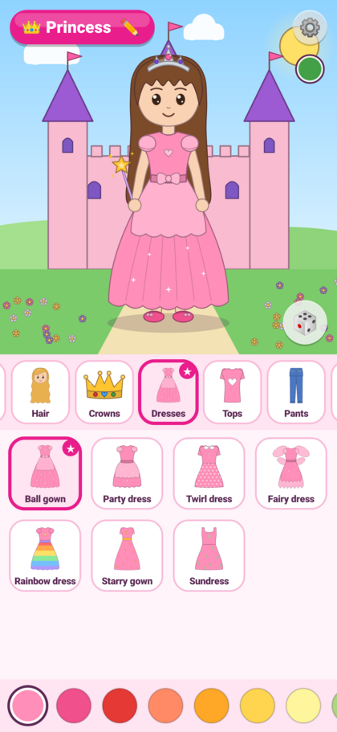
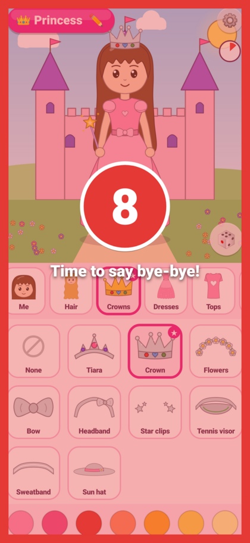
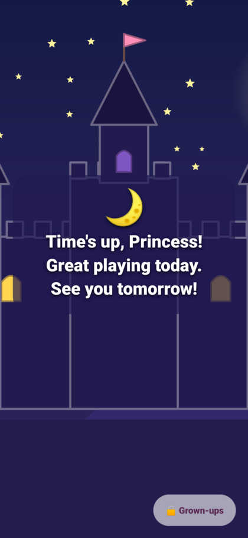
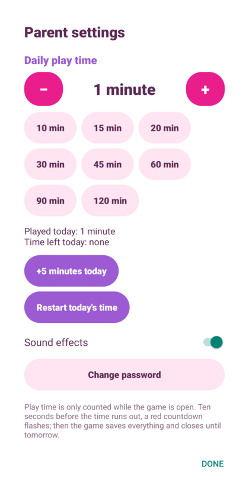
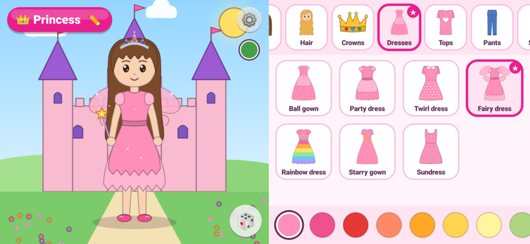

# Princess Dress-Up 👑

An Android dress-up game for young children (about 5 years old). Children name
their princess and dress her up: hair, clothes, pants and skirts, dresses, socks,
shoes, crowns, bags, wallets, purses, toys and sports kits for tennis, volleyball
and more. They can recolour every item, pick a place to play and choose the music.

There is **no makeup or lipstick anywhere** in the game. The princess's face is
just eyes, eyebrows, a nose and a simple brown smile, and a unit test
(`noMakeupAnywhere`) checks that no item or category names mention makeup.

The game has no ads, needs no internet connection and asks for no permissions.

<p align="center">
  
  
  
  
</p>
<p align="center">
  
</p>

## What children can do

| Tab | Choices |
| --- | --- |
| 👸 Me | Change the princess's name (type it, or tap a suggestion) and skin tone |
| Hair | 9 styles (long, wavy, ponytail, pigtails, bun, space buns, bob, braid, curly) in 12 colours |
| Crowns | Tiara, crown, flower crown, bow, headband, star clips, tennis visor, sweatband, sun hat |
| Dresses | Ball gown, party dress, twirl dress, fairy dress (with wings), rainbow dress, starry gown, sundress |
| Tops | T-shirt, puffy blouse, sweater, hoodie, star tee, stripy top, ruffle top |
| Pants | Long pants, shorts, leggings, skirt, tutu, long skirt |
| Sports | Tennis, volleyball, soccer, basketball, karate, ballet |
| Socks | Ankle, knee, stripy, spotty, frilly socks and tights |
| Shoes | Ballet flats, sneakers, boots, sandals, Mary Janes, sparkle slippers, rain boots |
| Bags | Handbag, purse, wallet, heart bag, tote bag, crossbody bag |
| Toys | Magic wand, flowers, balloon, tennis racket, volleyball, soccer ball, basketball, teddy bear |
| Places | Castle, garden, beach, snowy hills, starry night, rainbow, tennis court, beach volleyball, under the sea, bedroom |
| Music | Twinkle Star, Little Lamb, Brother John, Joy Song, London Bridge, Row Your Boat, Lullaby, or no music |

Every wearable item can be recoloured with the colour circles under the tiles.
The 🎲 button picks a surprise outfit, and tapping the princess makes her hop.

## For parents

**Parent settings** are behind the ⚙️ button in the top-right corner of the
stage. The first time, you create a parent password (at least 4 characters);
after that the password is required. In the settings you can:

* set **how many minutes per day** the game may be played (1–240, default 30),
* give **5 more minutes** today, or **restart today's time**,
* turn sound effects on or off,
* change the password.

How the daily limit works:

* Time is counted only while the game is open on screen, and starts again at
  midnight (device date). The pie under the ⚙️ button shows how much time is
  left; tapping it shows the minutes.
* **10 seconds before the time runs out, the screen flashes red and a big red
  countdown appears** (10, 9, 8 … 1).
* At zero the game **saves everything**, shows a friendly "Time's up! See you
  tomorrow" screen and **closes itself**. Opening it again on the same day shows
  that screen and closes again. A grown-up can tap **Grown-ups** on that
  screen, enter the password and add time.
* Progress is **saved automatically**: every change is saved straight away, and
  again when the game is closed, sent to the background or locked.
* While the password or settings screen is open, play time is paused.

Forgot the password? Go to Android **Settings → Apps → Princess Dress-Up →
Storage → Clear storage**. This also resets the game.

The limit relies on the device clock. If you need a limit that a child cannot
get around by changing the date, also use Android's own parental controls
(Google Family Link or Digital Wellbeing).

## Building

Requirements: Android Studio (recent version), JDK 17+, Android SDK 36.
The app runs on Android 8.0 (API 26) and newer, on phones and tablets, in
portrait and landscape.

* **Android Studio:** *File → Open* this folder, wait for the Gradle sync, then
  press *Run*.
* **Command line:** `./gradlew assembleDebug` builds
  `app/build/outputs/apk/debug/app-debug.apk`.
* **Unit tests:** `./gradlew testDebugUnitTest`
* **Art previews:** `./gradlew testDebugUnitTest --tests '*ArtPreviewTest*' -Dpreview.dir=/tmp/previews`
  writes SVG contact sheets of every item and background.

To publish on Google Play, create a release signing key and run
`./gradlew bundleRelease`.

## How it is made

The game uses only Kotlin and the Android framework: no AndroidX, no
third-party libraries, and no image or sound files.

* **Art** is vector drawing written in code. The princess lives in a
  600 × 1000 box, backgrounds in a 1000 × 1000 box. The same art model is
  drawn on Android's `Canvas` and exported to SVG in tests for previews.
* **Music and sound effects** are synthesized on the device from note lists of
  traditional public-domain tunes.

```
app/src/main/java/com/agmstech/princessgame/
├── MainActivity.kt        screen setup, play-time ticking, countdown, lockout, auto-save
├── art/                   vector model (Geometry, Elements) and all drawings
│   ├── BodyArt.kt         the princess (no makeup)
│   ├── HairArt.kt, HeadwearArt.kt, DressArt.kt, SeparatesArt.kt,
│   │   SportsArt.kt, FeetArt.kt, HeldArt.kt
│   └── Backgrounds.kt     the 10 places
├── wardrobe/              categories, catalogue, outfit rules, layering
├── core/                  saved game state, daily play-time tracker, parent password & settings
├── audio/                 songs, synthesizer, music player, sound effects
└── ui/                    stage, wardrobe panel, tiles, dialogs, countdown and lockout screens
```
